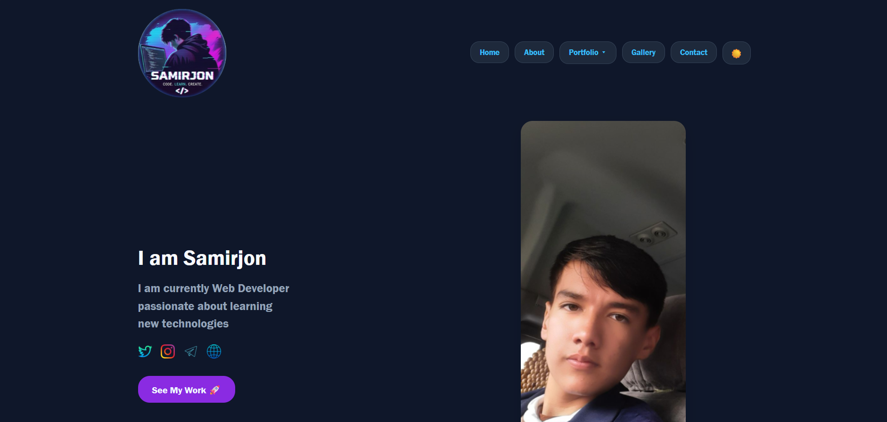

# 🚀 My First Portfolio Web Application

  **Zamonaviy, interaktiv va moslashuvchan (responsive) shaxsiy portfolio veb-sayti**

  [Live Demo](https://samirjon018.github.io/First-Protofoilo/)

  ---

## 📌 Loyiha Haqida

Ushbu loyiha mening front-end dasturlash bo'yicha egallagan ko'nikmalarim, amaliy loyihalarim va ijodiy yondashuvimni ko'rsatib beruvchi shaxsiy portfolio veb-saytimdir. Sayt foydalanuvchilar uchun qulay interfeys, zamonaviy **Dark Mode** uslubi hamda silliq animatsiyalar bilan boyitilgan.

> 💡 **Diqqatga sazovor qismi:** Saytda tezkor navigatsiya uchun `Ctrl + K` tugmalar birikmasi orqali ishlaydigan zamonaviy **Command Palette** komponenti va interaktiv vizual elementlar mavjud.

---

## 📸 Saytdan Ko'rinish (Preview)

---

## ✨ Asosiy Xususiyatlar

- 🎨 **Zamonaviy UI/UX:** Premium qorong'i (Dark Mode) uslubdagi interfeys va statistik kartalar.
- ⌨️ **Interactive Command Palette (`Ctrl + K`):** Sayt bo'ylab sichqonchasiz tezkor harakatlanish va buyruqlarni bajarish paneli.
- 🖼️ **Foto-galereya Setkasi:** CSS Grid yordamida yaratilgan chiroyli galereya bloki.
- ⚡ **Silliq Animatsiyalar:** GSAP (GreenSock Animation Platform) yordamida jonlantirilgan interaktiv elementlar.
- 📱 **To'liq Responsive:** Har qanday ekran o'lchamiga (Mobil, Planshet, Monitor) mukammal moslashuvchanlik.

---

## 🛠 Ishlatilgan Texnologiyalar

| Texnologiya | Vazifasi |
| :--- | :--- |
| **HTML5** | Semantik va strukturaviy veb-sahifa |
| **CSS3 (Flexbox/Grid)** | Vizual uslublar va moslashuvchan (responsive) layout |
| **JavaScript (ES6+)** | Interaktiv mantiq va Command Palette funksionali |
| **GSAP (GreenSock)** | Professional darajadagi UI animatsiyalari |
